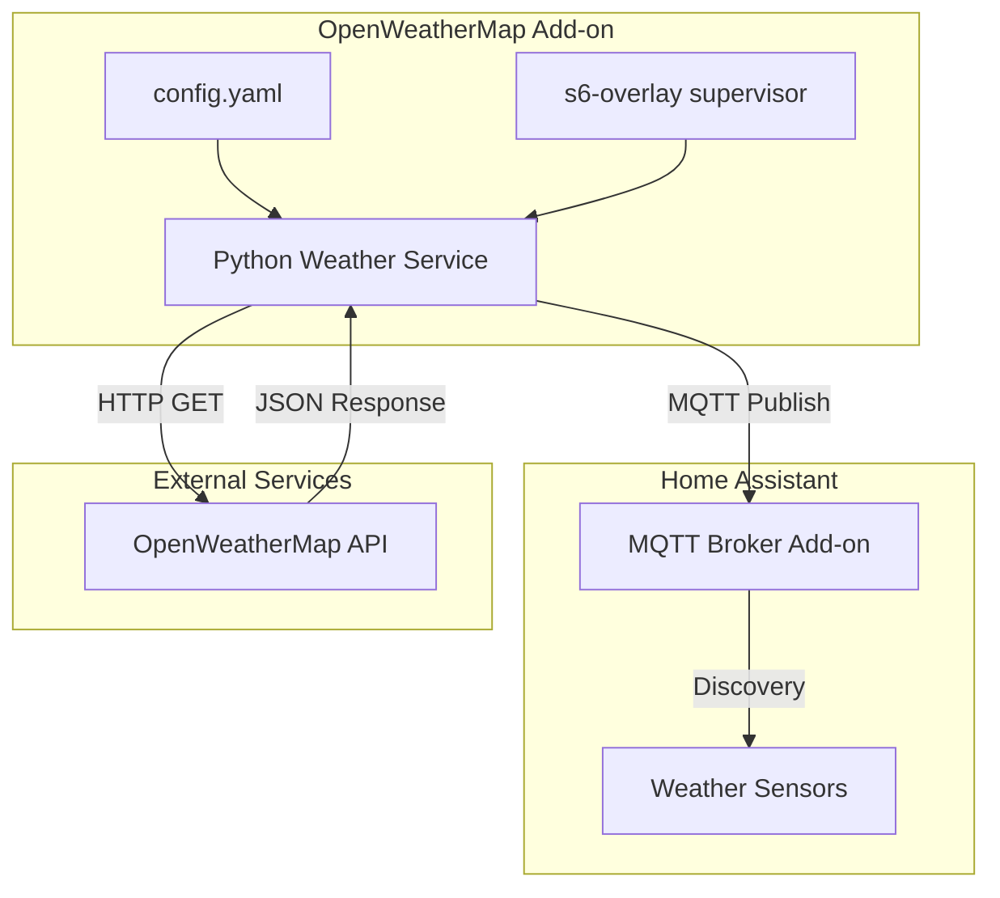
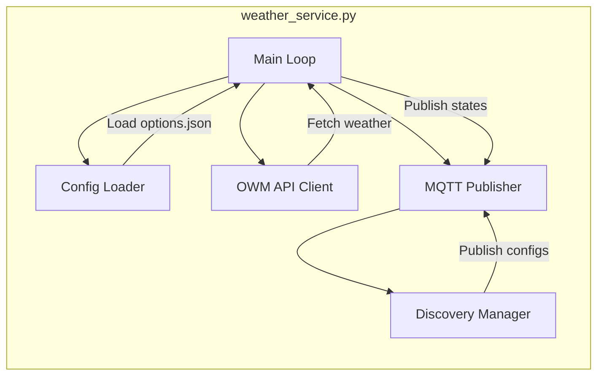

# OpenWeatherMap Home Assistant Add-on - Architecture Plan

## Overview

This document outlines the architecture for a Home Assistant add-on that integrates with the OpenWeatherMap API to provide weather data via MQTT Discovery sensors.

## Requirements Summary

| Requirement | Choice |
|-------------|--------|
| Weather API | OpenWeatherMap (free tier) |
| Data Exposure | MQTT Discovery (auto-creates sensors in HA) |
| Programming Language | Python |
| Update Frequency | Configurable (default: 10 minutes) |

## Architecture Diagram



## Directory Structure

```
openweathermap/
├── config.yaml           # Add-on configuration and schema
├── build.yaml            # Build configuration for architectures
├── Dockerfile            # Container build instructions
├── CHANGELOG.md          # Version history
├── DOCS.md               # User documentation
├── README.md             # Add-on description
├── icon.png              # Add-on icon (128x128)
├── logo.png              # Add-on logo (256x256)
├── translations/
│   └── en.yaml           # English translations for config UI
└── rootfs/
    ├── etc/
    │   └── services.d/
    │       └── openweathermap/
    │           ├── run       # Service start script
    │           └── finish    # Service cleanup script
    └── usr/
        └── bin/
            └── weather_service.py  # Main Python application
```

## Configuration Options

The add-on will expose the following configuration options to users:

| Option | Type | Required | Default | Description |
|--------|------|----------|---------|-------------|
| api_key | string | Yes | - | OpenWeatherMap API key |
| latitude | float | No | HA config | Location latitude |
| longitude | float | No | HA config | Location longitude |
| units | enum | No | metric | Temperature units: metric, imperial, standard |
| language | string | No | en | Language for weather descriptions |
| update_interval | int | No | 600 | Update interval in seconds |
| mqtt_host | string | No | core-mosquitto | MQTT broker hostname |
| mqtt_port | int | No | 1883 | MQTT broker port |
| mqtt_username | string | No | - | MQTT username |
| mqtt_password | string | No | - | MQTT password |

## Weather Data Points

The add-on will fetch and expose the following sensors via MQTT Discovery:

### Current Weather Sensors

| Sensor | Unit | Device Class | Description |
|--------|------|--------------|-------------|
| temperature | C/F | temperature | Current temperature |
| feels_like | C/F | temperature | Feels like temperature |
| humidity | % | humidity | Relative humidity |
| pressure | hPa | pressure | Atmospheric pressure |
| wind_speed | m/s or mph | wind_speed | Wind speed |
| wind_direction | degrees | - | Wind direction |
| clouds | % | - | Cloud coverage percentage |
| visibility | m | - | Visibility distance |
| weather_condition | - | - | Weather condition text |
| weather_description | - | - | Detailed weather description |
| weather_icon | - | - | OpenWeatherMap icon code |

### Optional Forecast Sensors

| Sensor | Description |
|--------|-------------|
| forecast_temp_min | Minimum temperature today |
| forecast_temp_max | Maximum temperature today |
| sunrise | Sunrise time |
| sunset | Sunset time |

## MQTT Discovery Format

Each sensor will be published with Home Assistant MQTT Discovery format:

**Discovery Topic Pattern:**
```
homeassistant/sensor/openweathermap/{sensor_name}/config
```

**Example Discovery Payload for Temperature:**
```json
{
  "name": "OpenWeatherMap Temperature",
  "unique_id": "owm_temperature",
  "state_topic": "openweathermap/sensor/temperature/state",
  "unit_of_measurement": "C",
  "device_class": "temperature",
  "state_class": "measurement",
  "device": {
    "identifiers": ["openweathermap_addon"],
    "name": "OpenWeatherMap",
    "manufacturer": "OpenWeatherMap",
    "model": "Weather API"
  }
}
```

**State Topic Pattern:**
```
openweathermap/sensor/{sensor_name}/state
```

## Python Application Architecture



### Module Responsibilities

1. **Config Loader**: Read `/data/options.json` for user configuration
2. **OWM API Client**: Make HTTP requests to OpenWeatherMap API
3. **Discovery Manager**: Generate and publish MQTT discovery configs
4. **MQTT Publisher**: Handle MQTT connection and message publishing
5. **Main Loop**: Orchestrate fetching and publishing on schedule

## Dependencies

### Python Packages

- `requests` - HTTP client for OpenWeatherMap API
- `paho-mqtt` - MQTT client library
- `python3` - Python 3.x runtime

### System Dependencies

- `curl` - For health checks (optional)

## Error Handling Strategy

1. **API Errors**: Log error, retry with exponential backoff, continue service
2. **MQTT Connection Errors**: Attempt reconnection with backoff
3. **Invalid Configuration**: Log clear error message, exit with non-zero code
4. **Network Errors**: Retry with backoff, maintain last known values

## Security Considerations

1. API key stored in add-on options (encrypted at rest by HA)
2. MQTT credentials optional but recommended
3. No sensitive data logged
4. Minimal container privileges required

## Implementation Steps

1. **Phase 1: Basic Structure**
   - Create directory structure
   - Create config.yaml with schema
   - Create build.yaml
   - Create basic Dockerfile

2. **Phase 2: Python Service**
   - Implement config loader
   - Implement OpenWeatherMap API client
   - Implement basic MQTT publishing

3. **Phase 3: MQTT Discovery**
   - Implement discovery message generation
   - Publish discovery configs on startup
   - Publish sensor states on schedule

4. **Phase 4: Service Integration**
   - Create s6-overlay run/finish scripts
   - Test service lifecycle
   - Add error handling and logging

5. **Phase 5: Documentation**
   - Create README.md
   - Create DOCS.md with setup instructions
   - Create CHANGELOG.md
   - Add translations

## Testing Plan

1. **Local Testing**: Run Python script standalone with mock data
2. **Container Testing**: Build and run Docker container locally
3. **Integration Testing**: Deploy to test Home Assistant instance
4. **MQTT Testing**: Verify discovery and state messages with MQTT explorer

## Future Enhancements

- Support for multiple locations
- Weather alerts/warnings
- Extended forecast data (5-day, hourly)
- Air quality data (requires different API endpoint)
- Weather maps integration